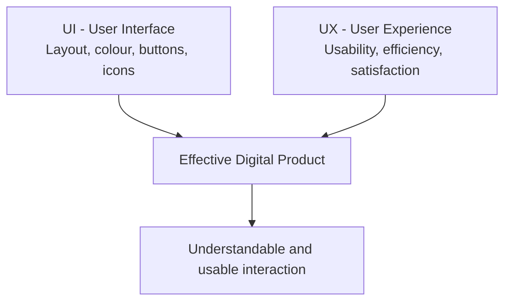

# UI-UX-Experiment1

## Aim

To explore the fundamentals of User Interface (UI) and User Experience (UX), differentiate UI and UX using real-world case studies, illustrate the relationship between UI and UX in design, and demonstrate various UI/UX design tools and their functionalities.

## a. Fundamentals of UI and UX

**User Interface (UI)** refers to the visual and interactive elements of a digital product that users interact with, including buttons, menus, typography, icons, colours and layout.

**User Experience (UX)** refers to the overall experience a person has while using a digital product, including usability, accessibility, efficiency, satisfaction and how easily they complete their goals.

UI focuses on the appearance and interaction elements, while UX focuses on how the product works for the user and how the user feels when using it.

## b. Difference between UI and UX using real-world case studies

### Case Study 1: Swiggy

- **UI observations:** Food images, restaurant cards, search field, category icons, buttons, colours and menu layout.
- **UX observations:** Finding restaurants, filtering food, viewing menus, adding items to a cart and completing an order.
- **UI/UX takeaway:** Clear visual elements help users understand available choices, while a well-organized ordering flow helps them complete their goal.

### Case Study 2: Amazon

- **UI observations:** Search bar, product images, price display, navigation, ratings and purchase buttons.
- **UX observations:** Searching products, comparing items, checking delivery details, adding products to a cart and completing checkout.
- **UI/UX takeaway:** A familiar interface and clear product information support the shopping journey and make product discovery and purchasing easier.

## c. Relationship between UI and UX

UI and UX are closely related but have different roles. UI provides the visual and interactive elements of a product, while UX ensures that those elements help users complete tasks easily and efficiently. An attractive interface without usability can frustrate users, while a usable product with poor visual clarity can be difficult to understand. Both need to work together to create an effective digital product.

### Relationship diagram

## d. Demonstration of UI/UX design tools

### Figma
Figma is a collaborative interface design tool used to create UI layouts, wireframes, prototypes, components and design systems. It supports collaboration and sharing designs.

**Features explored:**
- Frames and canvas
- Text and shape tools
- Components
- Auto Layout
- Prototype connections

### Adobe XD
Adobe XD is a design and prototyping tool used for designing interfaces and creating interactive prototypes.

**Main uses:** UI layout design, wireframes, interactive prototypes and design sharing.

### Canva
Canva is a visual design platform used to create graphics, presentations, mockups and simple visual design materials.

### Penpot
Penpot is an open-source design tool for creating interface designs, prototypes and collaborative design work.

## Output

The fundamentals of UI and UX were explored, their differences were examined through Swiggy and Amazon case studies, their relationship was illustrated using a diagram, and UI/UX design tools such as Figma, Adobe XD, Canva and Penpot were reviewed.

## Result

Thus, the fundamentals of UI/UX design were explored, UI and UX were differentiated using real-world case studies, their relationship in design was illustrated, and various UI/UX design tools and their features were demonstrated.
